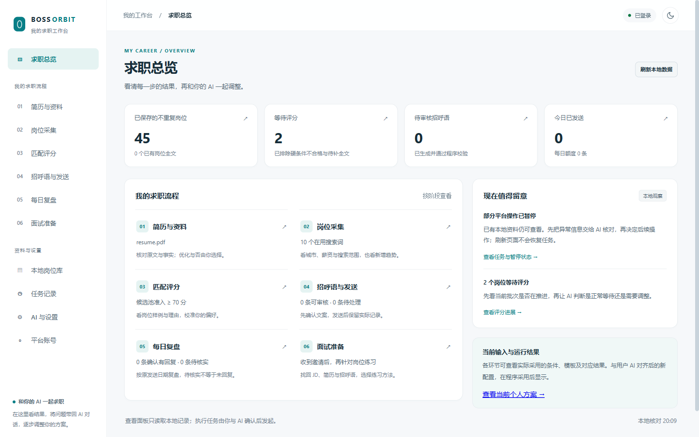
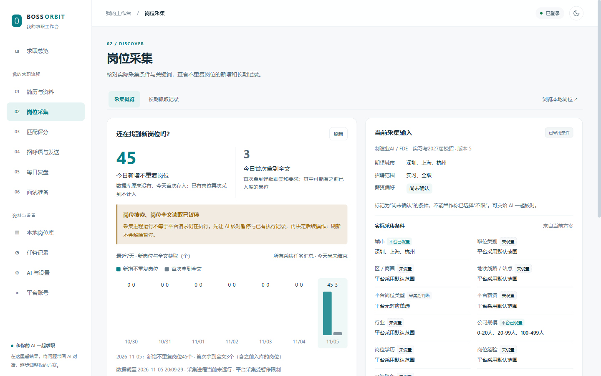
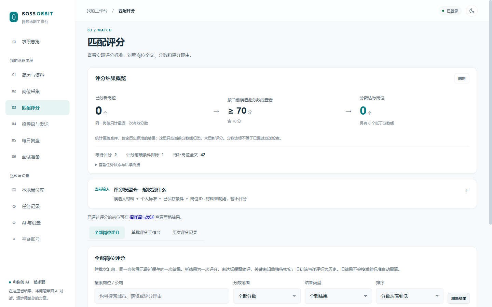
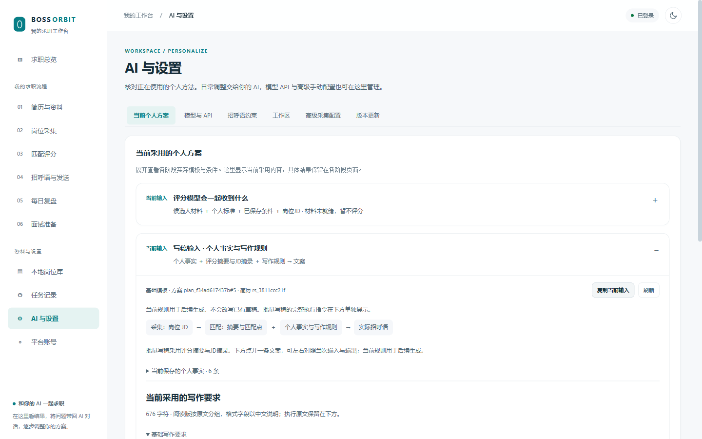

# BOSS Career · 和自己的 AI 一起求职

把简历和求职想法交给你正在使用的 AI，逐步确定找什么岗位、怎样判断匹配、招呼语怎么写，再通过本地程序执行并查看结果。

项目由 **程序 + Skill** 两部分组成：Skill 引导 AI 和你讨论需求，程序保存资料、执行任务，面板展示实际采用的条件与结果。你可以使用基础方法，也可以和 AI 一起调整每个环节。



## 可以做什么

| 环节 | 你和 AI 一起确定 | 程序负责 |
| --- | --- | --- |
| 简历 | 保留原样，或讨论、比较优化稿 | 保存原件和版本，记录当前采用资料 |
| 岗位来源 | 城市、方向、关键词、薪资、行业、公司规模等；区分硬条件与偏好 | 采集、去重、补全 JD，显示实际生效的筛选条件 |
| 匹配评分 | 哪些工作值得考虑、哪些要求必须满足 | 按资料和标准评分，保留理由、缺口及实际输入 |
| 招呼语 | 篇幅、口吻、经历选取和与岗位的对应关系 | 生成逐岗草稿，审核后按授权范围发送并留档 |
| 复盘与面试 | 根据回复调整方案；针对具体岗位练习 | 展示已记录的发送、回复与岗位资料，恢复面试材料 |

可以单独使用某个环节，也可以串联整批流程。**生成草稿、评分通过和用户授权发送是三个不同步骤。** 登录、验证码和平台要求的验证由本人完成。

## 先选一种开始方式

| 你的目的 | 启动方式 | 是否需要 BOSS 账号 |
| --- | --- | --- |
| 先体验求职流程 | 离线体验 `--mode demo` | 不需要；使用独立的虚构岗位，禁用平台操作 |
| 准备真实求职的资料和配置 | 首次设置 `--mode setup` | 设置阶段不校验登录，不执行历史任务 |
| 使用真实岗位并执行已授权任务 | 正常运行 `--mode run` | 采集、发送、回复同步需要有效账号 |

### 1. 安装程序

源码运行需要 Python 3.10+。真实平台操作还需要 Chrome 或 Edge。下面是 Windows PowerShell 的安装命令：

```powershell
git clone https://github.com/Alitailly/boss-career.git
cd boss-career/program
python -m venv .venv
.\.venv\Scripts\python.exe -m pip install -r requirements.txt
```

macOS / Linux 可使用虚拟环境中的 `bin/python` 执行后续命令；不同系统的平台操作能力需在实际环境验证。

### 2. 启动并交给 AI

**先体验，不登录：**

```powershell
.\.venv\Scripts\python.exe -m boss_web --mode demo --port 8792
```

程序会打开面板。把仓库交给能读本地文件、调用本地 HTTP 接口的 AI（如 Codex 或 Claude Code），并告诉它：

> 请阅读这个仓库的 `skill/boss-career/SKILL.md`，连接 `http://127.0.0.1:8792`。我想先离线体验求职流程，请使用本地示例岗位，带我完成资料确认、评分校准和招呼语草稿。已有信息直接沿用。

端口被占用时程序会顺延，请以终端打印的地址为准。

**准备真实使用：**

```powershell
.\.venv\Scripts\python.exe -m boss_web --mode setup
```

让 AI 读取同一份 Skill，并连接终端显示的服务地址。先建立工作区、上传简历、讨论目标和使用方法。需要真实平台任务时退出，再正常启动：

```powershell
.\.venv\Scripts\python.exe -m boss_web --mode run
```

正常模式启动后台任务执行器，并校验已有登录态；已有到期任务可能被接管。仅查看本地接口可使用 `--mode serve`，它不接管后台任务，也不进行启动登录校验。仅打开面板不代表授权发送。

### 3. 先看一小批结果，再调整

真实使用时：确认范围 → 小批采集 → 看不同类型岗位的评分 → 校准招呼语 → 按授权范围执行 → 根据实际回复复盘。

离线体验时：本地示例 JD → 核对求职者资料 → 校准评分 → 生成和审核草稿 → 选择岗位准备面试。采集、实际发送和回复同步留到真实环境单独验证。

你可以直接对 AI 说“这些岗位不相关”“这个分数太高”“这句不像我会说的话”，它应恢复对应输入，讨论修改并回读程序实际采用的配置。

## 离线体验

离线模式内置 5 份明确标记的虚构 JD，可以体验资料确认、评分、写稿和面试准备，无需先采集岗位。默认数据保存在独立的 `program/data-demo/`，重启后保留修改与设置。

示例用于测试流程，不代表真实招聘信息；离线模式不执行平台登录、采集、发送或回复同步。更多用法见 [离线体验指引](skill/boss-career/references/offline-experience.md)。

## 模型怎么使用

有两条执行路径：

| 路径 | 适合什么情况 |
| --- | --- |
| 由当前对话 AI 完成，再通过接口回写 | 想在对话中讨论、校准评分和文案；不要求程序另配后台模型 |
| 配置 OpenAI 兼容 API，由程序后台执行 | 需要程序批量解析、评分或写稿；在“AI 与设置 → 模型与 API”配置并测试 |

聊天产品的订阅或登录不会自动给程序提供 API Key。离线体验只禁用 BOSS 平台操作；选用外部模型时仍需要网络，可能产生调用费用，相关资料会提交给所选模型服务。

## 面板与接口

面板提供简历、本地岗位库、采集、匹配、招呼语、复盘、面试和任务记录。以实际输入、采用版本和任务结果为准，提交成功不等于执行完成。

<details>
<summary>展开查看其他界面</summary>





</details>

供 AI 接入的入口：`/api/ai/manifest`、`/api/ai/capabilities`、`/api/ai/context`；完整接口文档在 `/api/docs`。接口与执行限制见 [程序接入](skill/boss-career/references/current-integration.md)，以所连接版本返回的契约为准。

## 代码与本地数据

| 位置 | 内容 |
| --- | --- |
| `program/` | Python 程序、Web 面板、数据存取与工作流 |
| `skill/boss-career/` | AI 使用流程、操作指引及异常处理 |
| `docs/images/` | 面板截图 |
| `program/data/` | 默认运行数据；SQLite、登录态、模型配置、工作区版本与日志等 |
| `program/data-demo/` | 默认离线体验数据；与正常数据分开 |

实际数据位置会受环境变量和工作区设置影响，可查看 `/api/system/health`。运行数据和密钥不提交到仓库；分享日志或工作区前请自行检查其中的个人资料。

离线功能检查（在 `program/` 中）：

```powershell
.\.venv\Scripts\python.exe -m pip install httpx
.\.venv\Scripts\python.exe -m unittest discover -s tests -p test_demo.py -v
```

## 使用约定与许可

本项目供学习与个人求职辅助使用。请遵守目标平台协议和适用法律，尊重招聘方，不用于批量骚扰或数据倒卖。

请注意平台规则与请求频率：采集和发送可能触发风控或账号限制。出现异常提示时暂停操作，按平台官方指引处理。

MIT，见 [LICENSE](LICENSE)。
